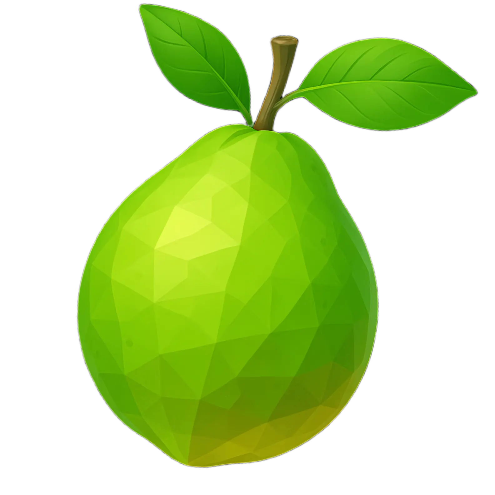

    

<h1 align="center">Koyaka</h1>

   Koyaka is a modern, open-source CSS library written in Sass. It is responsive and highly customizable. Works with plain HTML, React, Vue, SolidJS, or anything that renders HTML.

    <a href="https://koyaka.netlify.app/">Documentation</a>

## License

MIT © Madhan (Madhanmaaz)
